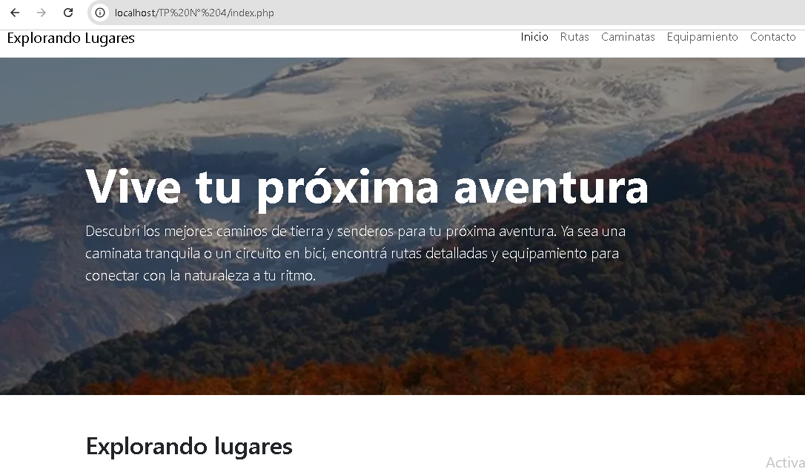
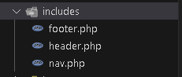
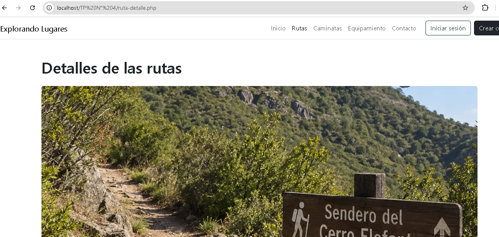
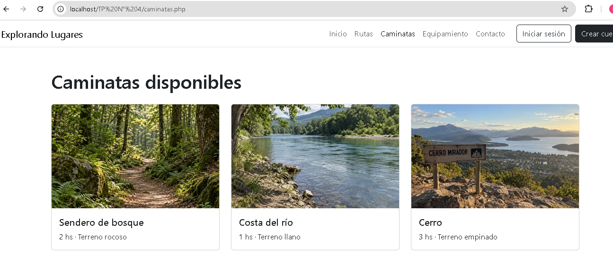
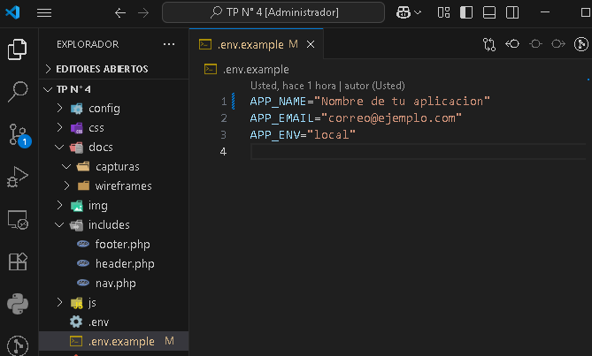
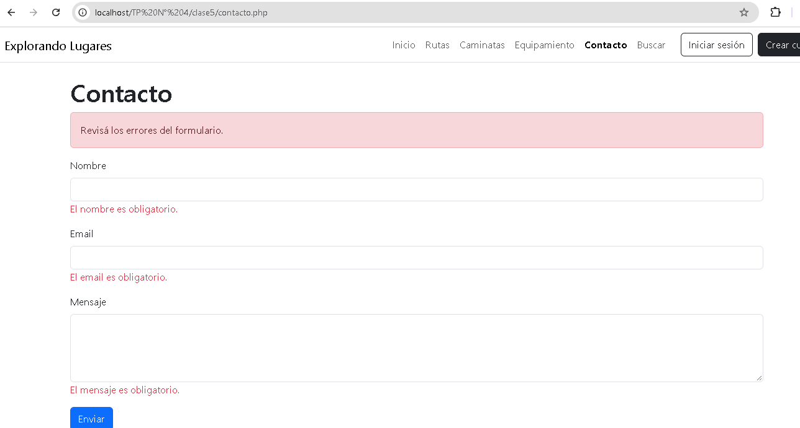
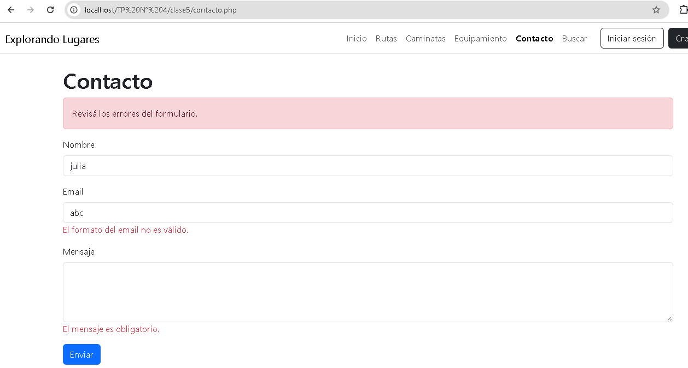
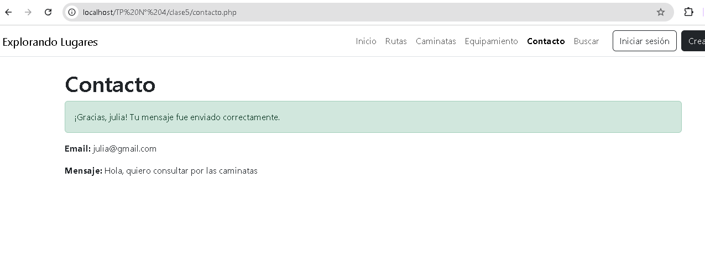
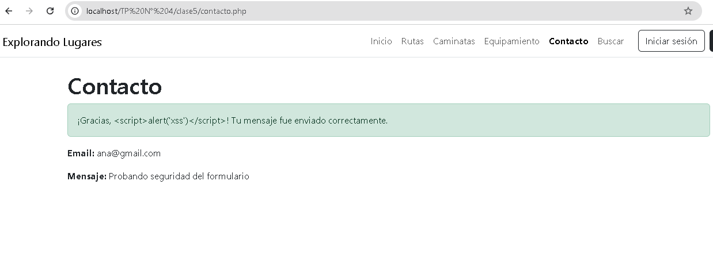
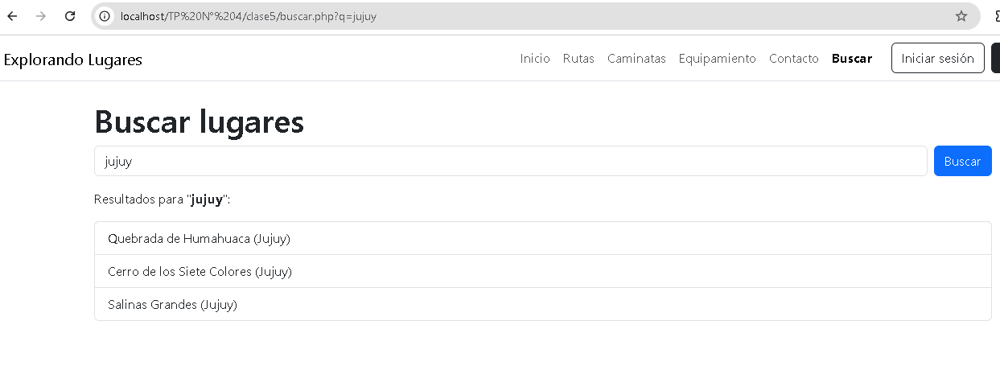

# Explorando lugares

Sitio web de rutas en bici, caminatas y equipamiento para actividades al aire libre. Este proyecto es la evolución de la maqueta estática del Hito 1 (HTML, CSS y Bootstrap): en el TP N° 4 se migró a **PHP**, se modularizó con **Server Side Includes (SSI)** para eliminar código duplicado y se incorporaron **variables de entorno (`.env`)** y títulos dinámicos, base de la arquitectura Server-Side Rendering.

## Resumen de la refactorización (Unidad 4)

- Las 10 vistas pasaron de `.html` a `.php`.
- Se extrajeron las partes repetidas a plantillas en `includes/`: `header.php` (head, metadatos y hojas de estilo), `nav.php` (menú) y `footer.php` (pie de página y scripts).
- Cada página define `$titulo_pagina` y `$descripcion_pagina` antes de incluir la plantilla, así el `<title>` y la meta descripción cambian según la vista.
- El menú resalta con la clase `active` la sección actual.
- Las variables globales (nombre de la aplicación, email de contacto y entorno) se leen desde `.env` mediante `config/env.php`.
- `.env` está excluido en `.gitignore` y se incluye `.env.example` como plantilla.

## Prototipo en Figma

[Ver diseño en Figma](https://www.figma.com/design/gZ57WNrR4t77iuQLHqTc4z/sitio-web--copia-?node-id=23-51&t=xxjSFO9o9xcTvURX-1)

## Tecnologías utilizadas

- HTML5 semántico
- CSS3 y Bootstrap 5.3
- JavaScript
- PHP 8
- XAMPP (Apache) como servidor local
- Git y GitHub (ramas y Pull Request)

## Estructura del proyecto

- `config/env.php`: lectura de las variables de entorno.
- `includes/`: `header.php`, `nav.php` y `footer.php`.
- `css/`, `js/`, `img/` y `docs/`: estilos, scripts, imágenes y documentación.
- Vistas: `index.php`, `caminatas.php`, `equipamiento.php`, `ruta-detalle.php`, `perfil.php`, `login.php`, `registro.php`, `galeria.php`, `nosotros.php` y `contacto.php`.
- `.env.example` y `.gitignore`.

## Instalación y ejecución local

1. Instalar XAMPP e iniciar el módulo **Apache** desde el panel de control.
2. Clonar el repositorio dentro de la carpeta `htdocs` de XAMPP: `git clone https://github.com/eugevs/TP4-Migracion-PHP-SSI.git explorando-lugares`
3. Dentro de la carpeta del proyecto, crear el archivo `.env` a partir de la plantilla: `copy .env.example .env`, y completar los valores.
4. Abrir en el navegador `http://localhost/TP%20N%C2%B0%204/index.php`.

## Evidencia de funcionamiento

### Servidor local ejecutándose

### Estructura modular (SSI)

### Navegación dinámica (menú activo según la página)

### Variables de entorno

## Flujo de trabajo con Git

Se trabajó en la rama `feature/migracion-php-ssi`, con commits por cada cambio (migración de vistas, plantillas, variables de entorno y documentación), integrada a `main` mediante un Pull Request.

## Autora

Vivas Florencia, IES N° 6001. Tecnicatura Superior en Análisis de Sistemas y Desarrollo de Software.

## Clase 5: Formularios POST y GET con sanitización

### Formulario POST: `clase5/contacto.php`
Formulario de contacto (nombre, email y mensaje) enviado por POST. Valida en el servidor que los campos no estén vacíos, que el email tenga formato válido y que el mensaje tenga al menos 10 caracteres. Muestra mensajes de error por campo, un mensaje de éxito al enviar y conserva lo escrito si hay errores.

### Formulario GET: `clase5/buscar.php`
Buscador de lugares por nombre o provincia, enviado por GET (`?q=`). Muestra los resultados o un mensaje si no hay coincidencias.

### Seguridad (XSS)
Los datos recibidos se limpian con `trim()` y `filter_input()`, y se muestran siempre con `htmlspecialchars()` (función `limpiar()` en `funciones.php`).

### Capturas

**Errores de validación**

**Persistencia de datos tras un error**

**Envío exitoso**

**Prueba de XSS (el script se muestra como texto y no se ejecuta)**

**Búsqueda por GET**

